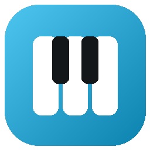
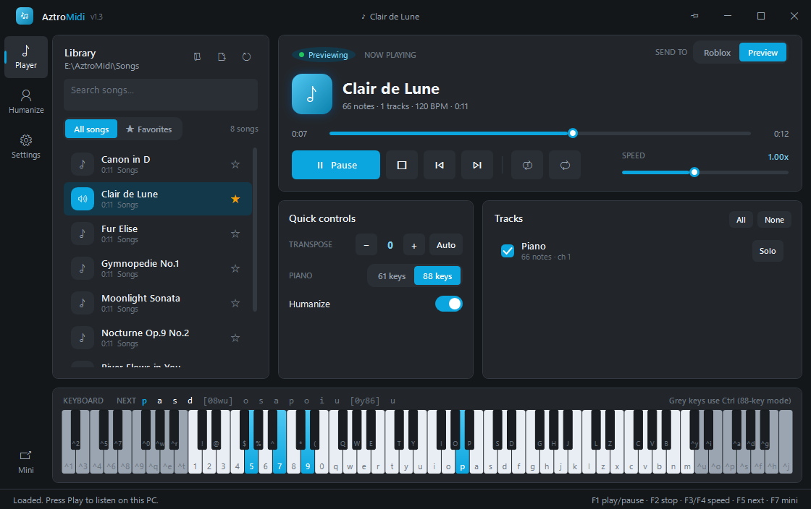
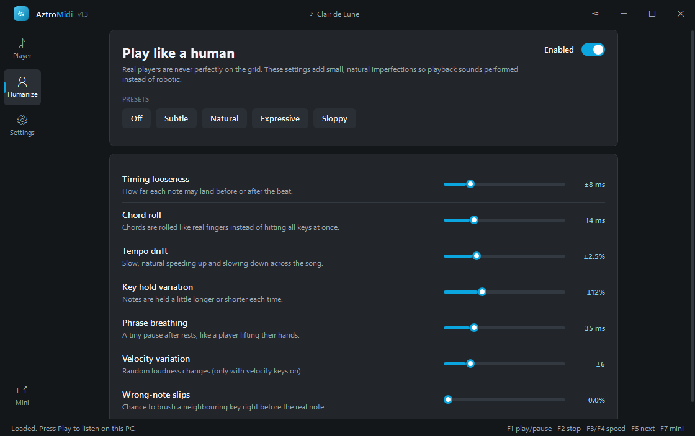
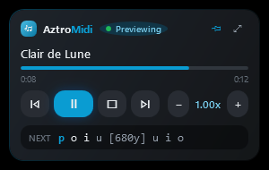

<div align="center">



# AztroMidi

**A lightweight MIDI auto-player for Roblox pianos, with playback that sounds human.**

[](https://github.com/Azmide/AztroMidi/releases/latest)
[](https://github.com/Azmide/AztroMidi/actions/workflows/ci.yml)
[](LICENSE)




</div>

## Why AztroMidi?

- **Tiny and fast.** A ~400 KB app with zero dependencies and sub-millisecond note timing.
- **Sounds human.** Loose timing, rolled chords, tempo drift and phrase breathing, not robotic playback.
- **Stays out of your way.** A mini player floats in the corner of Roblox and never steals focus.

## Download

Grab the latest version from **[Releases](https://github.com/Azmide/AztroMidi/releases/latest)**:

| File | For |
|---|---|
| `AztroMidi-x.y.z.exe` | Small download. Needs the [.NET 10 Desktop Runtime](https://dotnet.microsoft.com/download/dotnet/10.0) (Windows asks to install it on first start). |
| `AztroMidi-x.y.z-win-x64-standalone.zip` | Bigger, but runs on any Windows 10/11 x64 PC without installing anything. |

**First run:** Windows may show *"Windows protected your PC"* because AztroMidi is new and not
code-signed yet. Click **More info**, then **Run anyway**. Every release includes `SHA256SUMS.txt`
so you can check that your download is the original file.

## Quick start

1. Open AztroMidi and pick your MIDI folder with the folder icon in **Library**,
   or just drag `.mid` files onto the window. They are moved into your library folder.
2. Join a Roblox game with a piano and sit at it.
3. Pick a song and press **Play**. AztroMidi switches to Roblox and starts after a short countdown.
4. Press **F7** for the mini player in the corner of the game.

> Roblox pianos use Shift for black keys. If Shift Lock is on in the game, turn it off
> or some notes may not play.

## Features

### Playback
- Standard Roblox virtual piano layout (61 keys, C2–C7) and an **88-key mode** with the Ctrl extension
- Follows every tempo change in the MIDI file
- Speed from 0.25× to 2×, seek bar, previous / next, loop and auto-play next
- **Auto transpose** picks the key that fits the most notes
- Out-of-range notes are folded by octave or skipped
- Optional **sustain pedal** (Space) and **velocity keys** (Alt + key, 32 levels)
- Tracks with enable / disable and **Solo**; drum tracks are skipped automatically
- **Preview** mode plays the song through your PC speakers before you play it in-game

### Humanize



| Setting | What it does |
|---|---|
| Timing looseness | Each note lands slightly before or after the beat (bell-shaped, not uniform noise) |
| Chord roll | Chords are rolled like fingers, mostly upward, with a different spread each time |
| Tempo drift | Slow, smooth speeding up and slowing down across the song |
| Key hold variation | Keys are held a little longer or shorter each time |
| Phrase breathing | Tiny pauses after rests, like lifting your hands |
| Velocity variation | Random loudness changes (with velocity keys on) |
| Wrong-note slips | Optional: now and then a neighbouring key is brushed right before the real note |

Presets: **Off, Subtle, Natural, Expressive, Sloppy**.

### Mini player



- Sticks to the **top-right corner of the Roblox window** and follows it
- Clicking it never takes focus away from the game
- Shows progress, speed and the **next keys** in virtual piano sheet style (`t [tuo] y`)
- Drag it anywhere to unstick it; adjustable opacity

### Library
- Search, subfolders, **favorites** and song lengths
- **Drag & drop** downloaded `.mid` files (or whole folders) onto the window and they are moved
  into your library folder. Prefer copying? Change it in **Settings → Dropped MIDI files**
- Open `.mid` files straight from Explorer with *Open with → AztroMidi*
- Right-click a song to play it, favorite it, show it in its folder or remove it from the list
- Clicking a song while another one plays only selects it; double-click or Enter switches songs

### Quality of life
- Live piano visualizer with keyboard labels
- Reopens the last song, page, window size and position on start
- Global hotkeys that work inside Roblox
- Only plays while Roblox is focused, so keys never end up in Discord or your browser.
  Switch away and playback waits; press **F1** to jump back and continue
- Portable: settings are saved next to the exe in `settings.json`

## Hotkeys

| Key | Action |
|---|---|
| F1 | Play / Pause (jumps back to Roblox if playback is waiting) |
| F2 | Stop |
| F3 / F4 | Slow down / Speed up |
| F5 | Next song |
| F6 | Toggle humanize |
| F7 | Mini player |

All hotkeys can be changed in **Settings**.

Inside the AztroMidi window:

| Key | Action |
|---|---|
| Space | Play / Pause |
| ← / → | Seek 5 seconds |
| + / − | Speed up / Slow down |
| Enter | Play the selected song |
| Delete | Remove the selected song from the list |
| Ctrl+F | Search songs |
| Ctrl+O | Open MIDI files |
| Ctrl+1 / 2 / 3 | Player / Humanize / Settings |
| Ctrl+M | Mini player |

## FAQ

**Can it keep playing while I use another app?**
No. Roblox only accepts keyboard input while its window is active, and getting around that
would mean injecting into the game, which can get your account banned. AztroMidi waits
while you are away and continues when you come back (press F1 to jump back).

**Is this safe to use?**
AztroMidi only sends normal key presses, the same as typing on your keyboard. It does not
touch Roblox's memory or files.

**Where do I get MIDI files?**
Any `.mid` file works. Piano arrangements with one or two tracks sound best.

## Building from source

Requires Windows and the [.NET 10 SDK](https://dotnet.microsoft.com/download/dotnet/10.0).

```powershell
dotnet run --project src/AztroMidi            # run the app
dotnet run --project tests/AztroMidi.Tests    # run the tests
.\build.ps1                                   # build dist\AztroMidi.exe
.\build.ps1 -SelfContained                    # standalone build
```

## Contributing

Ideas, bug reports and pull requests are welcome. See **[CONTRIBUTING.md](CONTRIBUTING.md)** to get started
and **[CHANGELOG.md](CHANGELOG.md)** for what changed in each version.

## Credits

Inspired by [MIDI++](https://github.com/Zephkek/MIDIPlusPlus). AztroMidi is an independent
implementation written from scratch.

## License

[MIT](LICENSE) © Azmide
